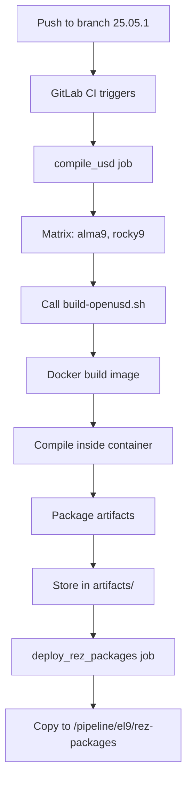
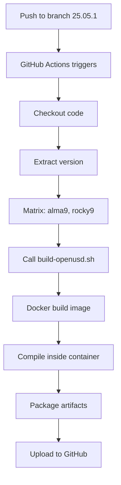

# OpenUSD Build Architecture

## Overview

This document describes the unified build architecture for OpenUSD containers. The design consolidates all build logic into a single Bash script, with CI/CD systems serving as thin orchestration layers.

## Architecture Principles

### Single Source of Truth

The unified build script (`scripts/build-openusd.sh`) is the authoritative implementation of the build process. It:

- Handles Docker image building
- Manages compilation environment setup
- Executes the OpenUSD build
- Packages artifacts
- Generates metadata and checksums

### CI/CD as Thin Layer

Both GitLab CI and GitHub Actions invoke the script with minimal logic:

- Platform matrix parallel execution
- Environment variable setup
- Artifact handling (GitLab deploy, GitHub Actions upload)
- No duplicate build logic

This reduces CI/CD configuration from ~400 lines to ~80 lines.

### Consistency Across Platforms

The script produces identical artifacts regardless of invocation context:

```
./scripts/build-openusd.sh --platform alma9 --version 25.05.1 --output artifacts
```

Same invocation works on:
- Local development (manual SSH)
- GitLab CI runners
- GitHub Actions self-hosted runners

## Components

### 1. Build Script (`scripts/build-openusd.sh`)

**Purpose:** Orchestrate the complete build process

**Responsibilities:**
- Argument validation (`--platform`, `--version`, `--output`)
- Docker prerequisites checking
- Docker image building (conditional with `--skip-image-build`)
- Container-based compilation
- Artifact packaging (tarballs, Rez structures)
- Manifest generation with checksums
- Error handling and logging

**Execution Flow:**

```
Input validation
  ↓
Docker availability check
  ↓
Dockerfile existence check
  ↓
Docker image build (optional)
  ↓
Compilation inside container
  ↓
Artifact verification
  ↓
Manifest generation
  ↓
Output reporting
```

**Key Features:**

- `--dry-run` mode for testing without execution
- `--skip-image-build` for reusing pre-built images
- Comprehensive error messages with `die()` function
- Structured logging with `log_info()`, `log_warn()`, `log_error()`
- `set -Eeuo pipefail` for robustness

### 2. Docker Images

**Files:**
- `docker/Dockerfile.alma9`
- `docker/Dockerfile.rocky9`

**Purpose:** Define reproducible build environments

**Fixed Components:**
- Base OS: AlmaLinux/Rocky 9.5
- Compiler: GCC 12.x via gcc-toolset-12
- Python: 3.10.14 (compiled from source)
- Dependencies: TBB, Boost, OpenEXR, OpenImageIO, GL/X11, Mesa
- Python packages: Jinja2, PySide6 6.5.2, PyOpenGL

**Build Args (passed by script):**
```dockerfile
ARG USD_VERSION=25.05.1
ARG USD_TARBALL_URL=https://github.com/PixarAnimationStudios/OpenUSD/archive/refs/tags/v25.05.1.tar.gz
ARG PYTHON_VERSION=3.10.14
ARG GCCCORE_VERSION=12.3.0
```

### 3. GitLab CI (`.gitlab-ci.yml`)

**Purpose:** Orchestrate builds on self-hosted GitLab runners

**Stages:**

1. **compile** – Parallel matrix builds
   - Invokes build script for alma9 and rocky9
   - Produces artifacts in `artifacts/{platform}/`
   - 14-day retention

2. **deploy** – Copy to Rez repository
   - Copies `artifacts/{platform}/rez/` to `/pipeline/el9/rez-packages`
   - Runs on shell runner (filesystem access)

**Matrix Parallel Execution:**
```yaml
parallel:
  matrix:
    - PLATFORM: [alma9, rocky9]
```

**Trigger Condition:**
Version branches matching regex: `^\d{2}\.\d{2}\.\d+$`

**Configuration:**
- Timeout: 4 hours
- Registry driver: overlay2 (with BuildKit)
- Environment: USD_VERSION (from branch), PYTHON_VERSION, GCCCORE_VERSION, REZ_DEPLOY_ROOT

### 4. GitHub Actions (`.github/workflows/build.yml`)

**Purpose:** Orchestrate builds on GitHub's self-hosted runners

**Jobs:**

1. **compile-usd** – Parallel matrix builds
   - Invokes build script for alma9 and rocky9
   - Produces artifacts in `artifacts/{platform}/`
   - Uploads to GitHub Actions storage (14-day retention)

**Matrix Parallel Execution:**
```yaml
strategy:
  matrix:
    platform: [alma9, rocky9]
```

**Trigger Conditions:**
- Push to version branch (pattern: `[0-9][0-9].[0-9][0-9].[0-9]*`)
- Manual workflow dispatch

**Configuration:**
- Timeout: 240 minutes (4 hours)
- Concurrency: Cancels in-progress builds on new push
- Runs-on: `[self-hosted, Linux, X64]` (WSL2 Ubuntu)
- No external registry deployment

**Version Extraction:**
```bash
VERSION="${{ github.ref_name }}"
if [[ ! "$VERSION" =~ ^[0-9]{2}\.[0-9]{2}\.[0-9]+$ ]]; then
  exit 1  # Invalid version format
fi
```

### 5. Rez Packages

**Files:**
- `rez/python/package.py` – Python 3.10.14
- `rez/openusd/package.py` – OpenUSD 25.05.1

**Features:**
- OS variants (`os-alma9`, `os-rocky9`)
- Consistent environment setup (PATH, LD_LIBRARY_PATH, PYTHONHOME)
- Cross-platform relocatability

**Generated by Script:**
```
artifacts/{platform}/rez/
├── python/
│   └── 3.10.14/
│       └── {platform}/  → [installation]
└── openusd/
    └── 25.05.1/
        └── {platform}/  → [installation]
```

### 6. Documentation

**Files:**
- `README.md` – User-facing quick start and reference
- `ARCHITECTURE.md` – This file

## Workflow Example: GitLab CI Build



## Workflow Example: GitHub Actions Build



## Artifact Structure

```
artifacts/
├── alma9/
│   ├── OpenUSD_install_25.05.1_alma9.tar.gz
│   ├── OpenUSD_build_25.05.1_alma9.tar.gz
│   ├── OpenUSD_3rdparty_25.05.1_alma9.tar.gz
│   ├── Python_3.10.14_alma9.tar.gz
│   ├── build.log
│   ├── manifest.json
│   └── rez/
│       ├── python/3.10.14/alma9/...
│       └── openusd/25.05.1/alma9/...
└── rocky9/
    ├── [same structure]
    └── rez/
        ├── python/3.10.14/rocky9/...
        └── openusd/25.05.1/rocky9/...
```

### manifest.json Example

```json
{
  "build_date": "2025-01-15T10:30:00Z",
  "platform": "alma9",
  "usd_version": "25.05.1",
  "usd_tarball_url": "https://github.com/PixarAnimationStudios/OpenUSD/archive/refs/tags/v25.05.1.tar.gz",
  "python_version": "3.10.14",
  "gcc_version": "12.3.0",
  "build_flags": ["--build-variant", "release", "--python", "--usdview", ...],
  "artifacts": {
    "install": {"file": "OpenUSD_install_25.05.1_alma9.tar.gz", "sha256": "..."},
    "build": {"file": "OpenUSD_build_25.05.1_alma9.tar.gz", "sha256": "..."},
    "3rdparty": {"file": "OpenUSD_3rdparty_25.05.1_alma9.tar.gz", "sha256": "..."},
    "python": {"file": "Python_3.10.14_alma9.tar.gz", "sha256": "..."}
  }
}
```

## Maintenance & Deployment

### Updating OpenUSD Version

1. Ensure Dockerfile supports new version's dependencies
2. Push version branch (e.g., `25.06.1`)
3. CI/CD automatically triggers via branch regex match
4. Build script derives tarball URL: `https://github.com/PixarAnimationStudios/OpenUSD/archive/refs/tags/v25.06.1.tar.gz`

### Updating Dependencies

1. Edit `docker/Dockerfile.alma9` and `docker/Dockerfile.rocky9`
2. Test locally: `./scripts/build-openusd.sh --dry-run ...`
3. Commit and push
4. Version branch push will rebuild with new Dockerfile

### Updating Build Flags

Edit `USD_BUILD_FLAGS` array in `scripts/build-openusd.sh`:

```bash
USD_BUILD_FLAGS=(
    "--build-variant" "release"
    "--python"
    "--usdview"
    # Add/remove flags as needed
)
```

## Design Decisions

### Why a Single Script?

**Rationale:**
- Reduces code duplication
- CI/CD systems orchestrate, don't implement
- Easier to test and debug
- Portable across execution contexts

**Alternative Considered:**
- Separate build logic per CI platform (rejected: violates DRY principle)

### Why Docker?

**Rationale:**
- Reproducible environments
- Decouples host OS from build OS
- Supports matrix parallel builds easily
- Same image tested locally and in CI

**Platforms Supported:**
- AlmaLinux 9 (GitLab runner base)
- Rocky 9 (Community alternative)

### Why Rez Packaging?

**Rationale:**
- Relocatable installations
- Environment isolation
- Multi-platform variants
- Integrates with existing VFX pipeline tooling

### Git Mirror Strategy

**GitLab as Authoritative:**
- GitLab CE self-hosted (internal infrastructure)
- GitHub as push mirror (external visibility)
- Both trigger builds identically via branch regex

## Testing

### Local Test (Dry Run)

```bash
./scripts/build-openusd.sh --platform alma9 --version 25.05.1 --output artifacts --dry-run
```

Shows commands without executing.

### Local Test (Skip Docker Image)

```bash
# First run (builds image)
./scripts/build-openusd.sh --platform alma9 --version 25.05.1 --output artifacts

# Second run (reuses image)
./scripts/build-openusd.sh --platform alma9 --version 25.05.1 --output artifacts --skip-image-build
```

### CI/CD Test

Push a test branch matching version pattern:

```bash
git push origin HEAD:25.99.0  # CI should trigger
```

## Troubleshooting

### Build fails in CI but works locally

**Cause:** Environment differences (Docker, git, disk space)

**Solution:**
1. Replicate CI environment locally
2. Check build.log in artifacts
3. Verify Docker image runs: `docker run -it openusd:alma9 bash`

### Rez packages not deployed

**Cause:** GitLab deploy job failed or shell runner unavailable

**Solution:**
1. Check GitLab deploy logs
2. Verify `/pipeline/el9/rez-packages` exists and is writable
3. Manual fallback: Copy `artifacts/{platform}/rez/` to deployment location

### GitHub Actions artifact upload fails

**Cause:** Disk space or permissions

**Solution:**
1. Check GitHub Actions logs
2. Verify `artifacts/` directory not empty
3. Check artifact size (GitHub 5GB default limit)

## Future Improvements

- [ ] Add optional remote registry push (GHCR, Docker Hub)
- [ ] Add artifact signature verification
- [ ] Add performance benchmarking to manifest
- [ ] Add incremental build support (cache Rez packages)
- [ ] Add automated platform-specific testing
- [ ] Add dependency version pinning via SemVer constraints
